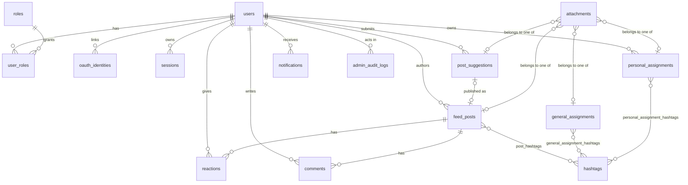

# Database (PostgreSQL 13+)

Schema lives in `src/database/migrations/` as plain, forward-only SQL. Run it with `npm run db:migrate`.

## Tables
| Area | Tables |
|---|---|
| Accounts & auth | `users`, `roles`, `user_roles`, `oauth_identities`, `sessions`, `login_attempts` |
| Assignments | `personal_assignments` (private, owned by a user), `general_assignments` (published by admins), `personal_assignment_hashtags`, `general_assignment_hashtags` |
| Feed | `feed_posts`, `post_suggestions` (student submissions awaiting moderation), `post_hashtags`, `hashtags`, `comments`, `reactions` |
| Files | `attachments` (metadata only; bytes go to object storage in Phase 4) |
| Operations | `notifications`, `admin_audit_logs` |



## Design decisions
- **IDs:** UUIDs (`gen_random_uuid()`, built in from PG13, no extensions), so IDs are not guessable or enumerable. Hashtags and the audit log use identity integers because they are internal.
- **Integrity in the database, not only in code:** CHECK constraints mirror the validators (lengths, enums, `done` ⇔ `completed_at`, published ⇒ `published_at`, pending ⇔ not yet reviewed). Case-insensitive uniqueness for email and hashtags uses `lower()` unique indexes.
- **Every foreign key states `ON DELETE`** and has an index starting with the FK column (checked by `tests/backend/schema.test.js`). Private assignments cascade-delete with their owner.
- **Ownership:** every personal-assignment query must filter by the signed-in user's id. Attachments have exactly one owner (`CHECK num_nonnulls(...) = 1`), so access to a private attachment is decided via `personal_assignments.user_id`.
- **Secrets:** only `password_hash` (scrypt, self-describing format) and `sessions.token_hash` (SHA-256 of the cookie token; `sessions.kind` is `user` or `admin`, added in migration 0006) are stored, never raw passwords or tokens. `login_attempts.identifier_hash` is a keyed hash so unknown usernames can be throttled without storing them.
- **Admin lockout** persists in `users.failed_login_count` / `locked_until`, so it survives restarts, other devices and cleared browser storage. The reset time is computed in `SERVER_TIMEZONE`.
- **Audit log is append-only:** triggers reject UPDATE, DELETE and TRUNCATE. Its `actor_id` uses `ON DELETE RESTRICT`, so accounts with history are suspended (`users.status`), not hard-deleted.
- **Search:** `feed_posts.search_vector` is a generated `tsvector` with a GIN index; hashtag filtering uses `post_hashtags`.
- **Roles** (`student`, `lecturer`, `admin`) are reference data inserted by migration `0002`. **No admin user and no password is created by any migration or seed.**

## Writing migrations
1. Add `NNNN_short_description.sql` with the next number (4 digits, snake_case). Never edit an applied file: the runner stores a SHA-256 checksum and refuses changed files. Fix mistakes with a new migration.
2. Each file runs in one transaction. Do not write `BEGIN`/`COMMIT`, and avoid statements that cannot run in a transaction (`CREATE INDEX CONCURRENTLY`).
3. Always give foreign keys an explicit `ON DELETE`, index them, and add the `set_updated_at` trigger to tables with `updated_at`.
4. Run `npm test` (structure checks) and the integration test (below).

## Commands
```bash
npm run db:migrate   # apply pending migrations (advisory-locked, safe to run concurrently)
npm run db:status    # applied / pending / MODIFIED
npm run db:seed      # development sample data (refuses to run when NODE_ENV=production)
npm run admin:bootstrap  # create the first administrator (see docs/auth.md)
npm run db:reset     # DEV ONLY: drops the public schema, re-migrates. Needs NODE_ENV=development, a localhost DB and --yes
```

## Testing against a real database
```bash
createdb student_hub_test
TEST_DATABASE_URL=postgres://localhost:5432/student_hub_test npm test
```
`tests/backend/integration/db.integration.test.js` creates a throw-away schema, applies every migration, loads the seeds, checks the constraints above (duplicates, enum/CHECK violations, cascade and restrict behavior, append-only audit log, triggers, full-text search) and drops the schema. It never touches `public`.
